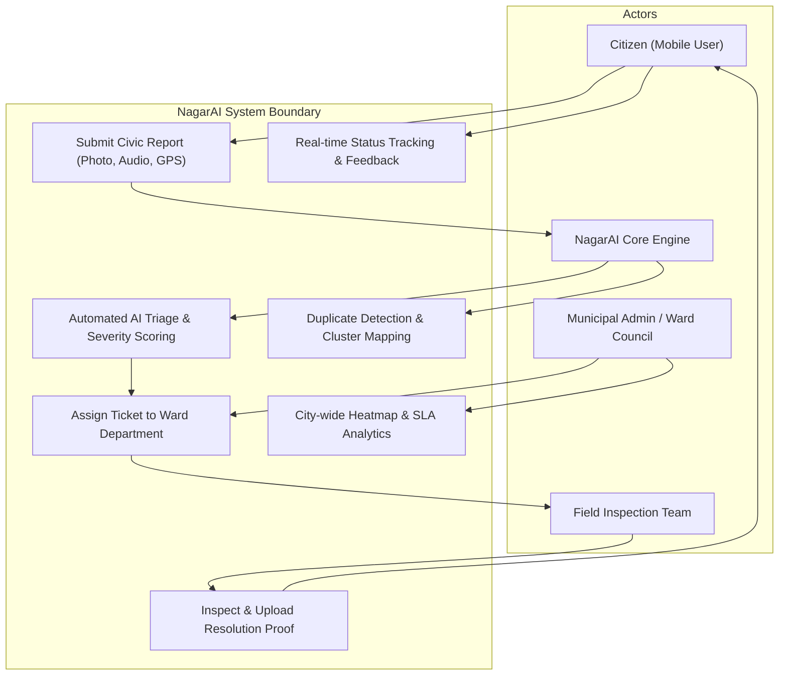
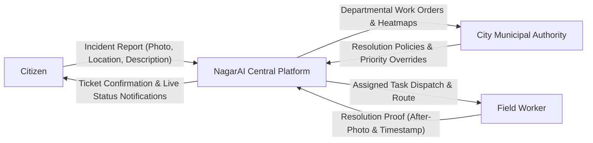
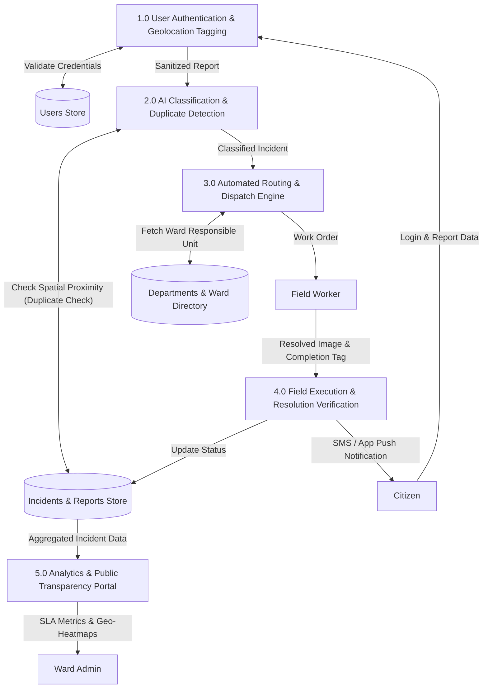
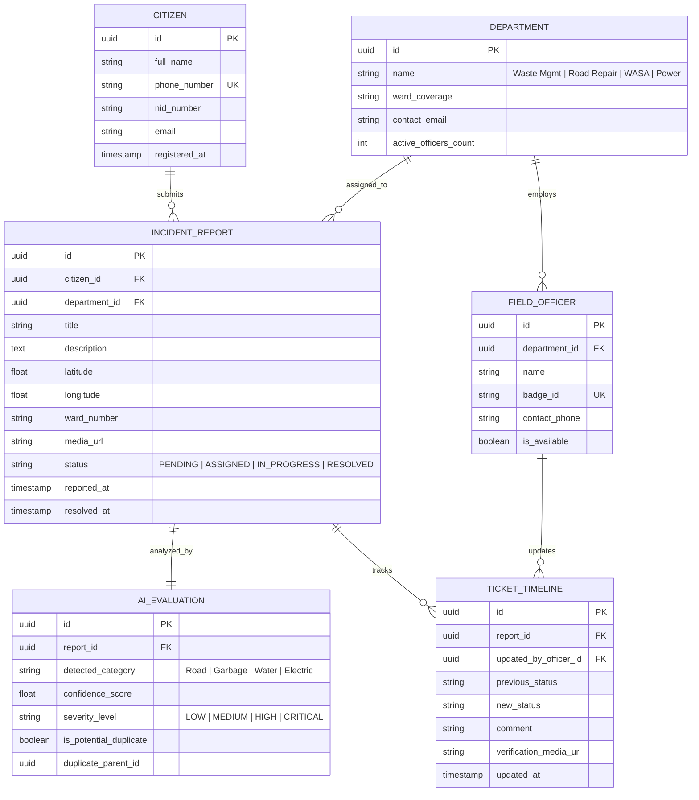
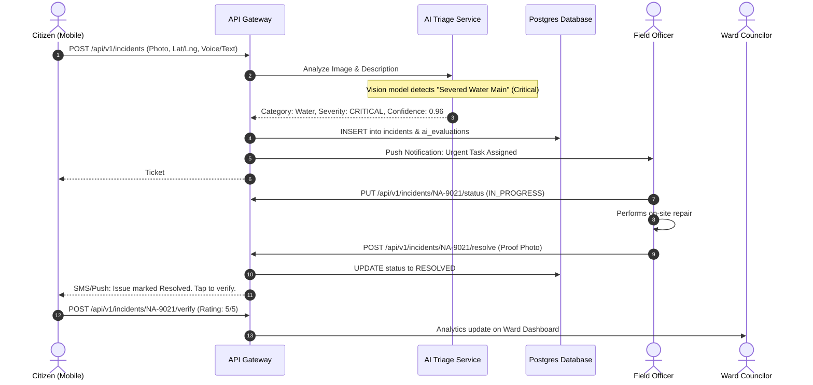

# 🏙️ NagarAI (নগর-এআই)
### Next-Gen AI-Powered Civic Issue Reporting & Smart Municipal Governance Platform

[%20Lab-blue?style=for-the-badge)](docs/SRS.md)
[](https://www.figma.com/design/Zr7zPutMbLYQQgD0HS2oc0/NagarAI-Mobile?node-id=0-1&t=OQEn6nY5H6vatiCX-1)
[](https://www.figma.com/design/xPXYxt9vMviNMMru0UGfWc/NagarAI-Desktop?t=OQEn6nY5H6vatiCX-1)
[](LICENSE)

---

## 📌 1. Project Overview & Motivation

In rapidly urbanizing cities, municipal corporations struggle to detect, categorize, prioritize, and resolve localized civic grievances—such as illegal roadside dumping, open potholes, waterlogging, ruptured water supply pipes, and dysfunctional streetlamps. Traditional manual complaint management hotlines suffer from:
1. **High Bureaucratic Latency**: Unstructured complaints bouncing between incorrect departments.
2. **Lack of Transparency**: Citizens have zero visibility into task assignment or ground progress.
3. **Absence of Intelligent Prioritization**: Critical public safety hazards (e.g., exposed electric wires) get buried under standard requests.

**NagarAI** bridges the gap between citizens and municipal authorities by combining **Mobile Crowdsourcing** with **Computer Vision and NLP Triage**. Citizens upload photos/videos with automated geo-tagging; the NagarAI engine automatically classifies issue type, estimates severity, assigns jurisdiction, dispatches field officers, and monitors resolution SLAs.

---

## 🎨 2. UI/UX Prototypes (Figma Direct Links)

The user interface and user experience have been systematically researched, wireframed, and prototyped in Figma for both Mobile (Citizen-Centric) and Desktop (Administrative Command Center) viewports:

| Platform | Target Audience | Interactive Figma Prototype |
| :--- | :--- | :--- |
| **📱 NagarAI Mobile App** | Citizens, Field Workers | [🔗 Open NagarAI Mobile Prototype](https://www.figma.com/design/Zr7zPutMbLYQQgD0HS2oc0/NagarAI-Mobile?node-id=0-1&t=OQEn6nY5H6vatiCX-1) |
| **🖥️ NagarAI Desktop Portal** | City Ward Councilors, Municipal Officers, Admins | [🔗 Open NagarAI Desktop Prototype](https://www.figma.com/design/xPXYxt9vMviNMMru0UGfWc/NagarAI-Desktop?t=OQEn6nY5H6vatiCX-1) |

---

## 🧠 3. System Analysis & Design (SAD) Architecture

This repository contains full software engineering artifacts adhering to IEEE standards for System Analysis and Design.

### 3.1. Use Case Diagram
The diagram below illustrates the interactions between Primary Actors (**Citizen**, **Field Officer**, **Municipal Admin**) and the **NagarAI Triage Engine**.



---

### 3.2. Data Flow Diagram (DFD Level 0 - Context Level)
High-level information boundary between external entities and the central NagarAI system.



---

### 3.3. Data Flow Diagram (DFD Level 1 - Process Breakdown)
Detailed internal processes for reporting, machine learning triage, assignment, and feedback verification.



---

### 3.4. Entity Relationship Diagram (ERD)
Relational schema designed for high-concurrency municipal data and GIS spatial querying.



---

### 3.5. System Sequence Diagram (Incident Lifecycle)



---

## ⚡ 4. Core Features & Capabilities

1. **Multimodal Incident Reporting**:
   - Audio notes in Bengali & English transcribed automatically using Whisper AI.
   - High-precision GPS reverse-geocoding (Ward, Thana, District, Road detection).
2. **Computer Vision Damage Assessment**:
   - Classifies potholes, open drainage, trash accumulation, hazardous wires.
   - Filters out spam or non-civic photos automatically.
3. **Automated Triage & Deduplication Engine**:
   - Clusters incident reports within a 25-meter spatial radius and flags duplicates.
   - Prevents overwhelming field teams with 20 tickets for the same pothole.
4. **Administrative Command Center (Desktop)**:
   - Dynamic Geo-JSON Heatmaps showing problem clusters across city zones.
   - SLA tracking countdown timers ensuring accountability.
5. **Transparency & Citizen Feedback Loop**:
   - Double-verification system: A ticket is not closed until the citizen verifies the "After" proof photo or the grace period expires.

---

## 📁 5. Repository Structure

```text
NagarAI/
│
├── .github/
│   └── workflows/
│       └── ci.yml               # Automated CI Workflow & Schema Validation
│
├── docs/                        # Comprehensive System Analysis & Design Docs
│   ├── SRS.md                   # IEEE-830 Software Requirements Specification
│   ├── SYSTEM_DESIGN.md         # Architecture, Modular Design & Security Protocols
│   └── USER_STORIES.md          # Agile Epics, User Stories & Acceptance Criteria
│
├── prototype/                   # Working Interactive Frontend Showcase
│   ├── index.html               # Responsive Live Dashboard Prototype (Tailwind CSS)
│   ├── app.js                   # Interactive client-side triage simulation
│   └── styles.css               # Styling and theme overrides
│
├── LICENSE                      # MIT Open Source License
└── README.md                    # Project Manifesto, Architecture & Diagrams
```

---

## 🚀 6. Running the Interactive Prototype

An interactive web prototype is included in this repository to showcase the core user journeys designed in Figma:

```bash
# Clone the repository
git clone https://github.com/mahamudul-hasan7/NagarAI.git

# Navigate to prototype
cd NagarAI/prototype

# Open directly in your browser
start index.html   # On Windows
# or open with Live Server in VS Code
```

---

## 👨‍💻 Author & Academic Information

- **Student Name**: Mahamudul Hasan
- **Degree**: B.Sc. in Computer Science and Engineering (CSE)
- **Course**: System Analysis and Design (SAD) Lab
- **Academic Term**: Fall 2026
- **Contact**: [mahamud.7info@gmail.com](mailto:mahamud.7info@gmail.com)
- **GitHub**: [@mahamudul-hasan7](https://github.com/mahamudul-hasan7)

---

<p align="center">
  <b>Made with ❤️ for Smarter, Cleaner, and Safer Cities in Bangladesh</b>
</p>
