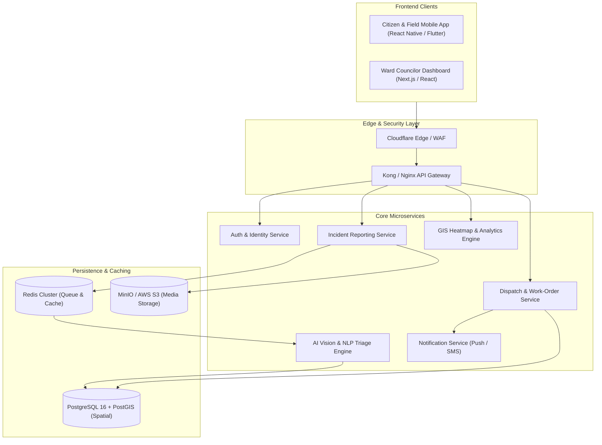

# 📐 System Design & Technical Specification for NagarAI

This document outlines the architectural blueprint, data model, microservice decomposition, and API contracts for **NagarAI**.

---

## 1. High-Level Architectural Pattern

NagarAI employs an **Event-Driven Microservices Architecture** with an API Gateway serving as the single entry point for cross-platform clients.



---

## 2. Component Breakdown

### 2.1 API Gateway & Auth Service
- **Token Management:** Issues asymmetric RS256 JWT tokens.
- **Rate Limiting:** Protects report submission endpoints (maximum 5 submissions per minute per IP/Device ID to prevent DoS attacks).

### 2.2 AI Vision & Triage Microservice
- **Image Preprocessing:** Strips EXIF metadata for privacy while preserving GPS coordinates, resizes to $640 \times 640$ pixels.
- **Classification Engine:** Convolutional Neural Network (YOLOv8 / ResNet) fine-tuned on civic defect datasets (potholes, garbage dumps, clogged drains).
- **Severity Heuristic Matrix:**
  $$\text{Severity Score} = (\text{Confidence} \times w_c) + (\text{Hazard Index} \times w_h) + (\text{Population Density Factor} \times w_p)$$
  Where:
  - $w_c = 0.3$ (Model confidence weight)
  - $w_h = 0.5$ (Inherent hazard: exposed live wire > small trash bag)
  - $w_p = 0.2$ (Zone density / traffic volume)

### 2.3 Dispatch & Geospatial Engine
- **Spatial Queries:** Uses PostGIS functions (`ST_DWithin`, `ST_Contains`) to match incident coordinates against municipal Ward Boundary GeoJSON polygons.
- **Deduplication Radius:**
  ```sql
  SELECT id, title, reported_at
  FROM incident_reports
  WHERE status != 'RESOLVED'
    AND category = $1
    AND ST_DWithin(geom, ST_SetSRID(ST_MakePoint($longitude, $latitude), 4326)::geography, 25.0);
  ```

---

## 3. RESTful API Contract

### 3.1 Submit Incident Report
* **Endpoint:** `POST /api/v1/incidents`
* **Authentication:** Bearer JWT (Role: Citizen)
* **Headers:** `Content-Type: multipart/form-data`

#### Request Payload:
```json
{
  "title": "Severe road cavity near Dhanmondi 27",
  "description": "Large pothole causing major vehicle disruption after rain.",
  "latitude": 23.7538,
  "longitude": 90.3758,
  "voice_note": "<binary_audio_blob>",
  "images": ["<binary_jpeg_blob>"]
}
```

#### Response (201 Created):
```json
{
  "success": true,
  "incident_id": "c7a8b609-12f4-4d8e-9021-3e4b7a1d5a89",
  "ticket_number": "NA-2026-DHN-041",
  "ai_analysis": {
    "detected_category": "Roads & Footpaths",
    "detected_sub_issue": "Pothole / Road Depression",
    "confidence": 0.94,
    "severity": "HIGH",
    "assigned_ward": "Ward 15, Dhaka South City Corporation",
    "estimated_sla_hours": 48
  },
  "status": "ASSIGNED",
  "created_at": "2026-10-30T17:35:10Z"
}
```

---

### 3.2 Field Officer Resolution Update
* **Endpoint:** `POST /api/v1/incidents/{incident_id}/resolve`
* **Authentication:** Bearer JWT (Role: FieldOfficer)

#### Request Payload:
```json
{
  "completion_notes": "Cavity filled with asphalt and compacted.",
  "proof_image": "<binary_after_photo_blob>",
  "current_latitude": 23.7539,
  "current_longitude": 90.3757
}
```

#### Response (200 OK):
```json
{
  "success": true,
  "incident_id": "c7a8b609-12f4-4d8e-9021-3e4b7a1d5a89",
  "status": "PENDING_CITIZEN_VERIFICATION",
  "verification_window_closes_at": "2026-11-01T17:35:10Z"
}
```

---

## 4. Database Schema Specification (DDL)

```sql
CREATE EXTENSION IF NOT EXISTS "uuid-ossp";
CREATE EXTENSION IF NOT EXISTS "postgis";

CREATE TABLE citizens (
    id UUID PRIMARY KEY DEFAULT uuid_generate_v4(),
    full_name VARCHAR(100) NOT NULL,
    phone_number VARCHAR(15) UNIQUE NOT NULL,
    nid_hash VARCHAR(64),
    created_at TIMESTAMP WITH TIME ZONE DEFAULT CURRENT_TIMESTAMP
);

CREATE TABLE departments (
    id UUID PRIMARY KEY DEFAULT uuid_generate_v4(),
    name VARCHAR(50) NOT NULL,
    code VARCHAR(10) UNIQUE NOT NULL,
    head_officer_name VARCHAR(100),
    email VARCHAR(100) NOT NULL
);

CREATE TABLE incident_reports (
    id UUID PRIMARY KEY DEFAULT uuid_generate_v4(),
    ticket_number VARCHAR(30) UNIQUE NOT NULL,
    citizen_id UUID REFERENCES citizens(id) ON DELETE CASCADE,
    department_id UUID REFERENCES departments(id),
    title VARCHAR(150) NOT NULL,
    description TEXT,
    category VARCHAR(50) NOT NULL,
    severity VARCHAR(20) DEFAULT 'MEDIUM' CHECK (severity IN ('LOW', 'MEDIUM', 'HIGH', 'CRITICAL')),
    status VARCHAR(30) DEFAULT 'PENDING' CHECK (status IN ('PENDING', 'ASSIGNED', 'IN_PROGRESS', 'RESOLVED', 'REJECTED')),
    geom GEOMETRY(Point, 4326) NOT NULL,
    media_url TEXT NOT NULL,
    resolution_media_url TEXT,
    created_at TIMESTAMP WITH TIME ZONE DEFAULT CURRENT_TIMESTAMP,
    resolved_at TIMESTAMP WITH TIME ZONE
);

CREATE INDEX idx_incidents_geom ON incident_reports USING GIST(geom);
CREATE INDEX idx_incidents_status ON incident_reports(status);
```
